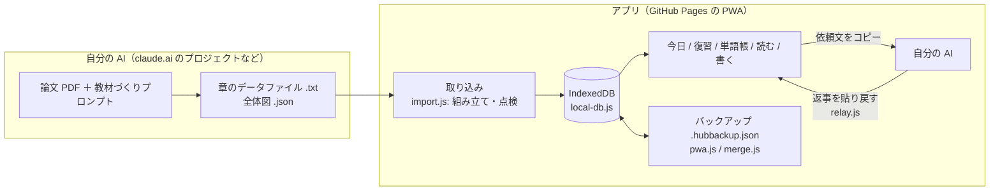

# Paper Reader Hub（論文リーダー学習ハブ）

**読みたい論文が、そのまま英語の教材になる。**
英語の論文を「訳に頼らず、英語のまま読める」ようになるための、スマホ向けの学習アプリです。

**[アプリを開く](https://maitona.github.io/paper-reader-hub/)** ・ [使い方](docs/usage.md) ・ [教材の作り方](prompts/README.md) ・ [利用規約と注意事項](docs/terms.md)

## こんな人のためのアプリです

- 研究室に入って、**英語の論文を読む必要が出てきた**学部生・大学院生（分野は問いません）
- 辞書と翻訳を行ったり来たりして、**1本読むのに何日もかかってしまう**人
- 単語帳の単語ではなく、**自分の分野の論文に出てくる言葉と言い回し**を身につけたい人
- いずれ自分で論文や発表スライドを**英語で書く**ことになる人

英語の力は、中級（TOEIC 600〜700 点くらい）を想定しています。

<p>
  
  
  
  
</p>

<sub>画面の英文は、このアプリのために書いた見本です（論文からの引用ではありません）。</sub>

## ほかの英語学習アプリと違うところ

**1. 教材は、あなたの AI が作る。アプリは学習に専念する。**
アプリには教材が入っていません。読みたい論文の PDF を自分の AI（Claude など）に渡して、公開している[教材づくりプロンプト](prompts/paper-reader-prompt.md)で章ごとの教材にしてもらい、それをアプリに取り込みます。
だから電気でも生物でも経済でも、**今まさに読む必要がある論文**で練習できます。教材の書き方は決まっていて、アプリが取り込む前に形を点検します。

**2. API キーも、サーバーも、登録もいらない。**
英作文の添削も、アプリが AI を直接呼ぶのではなく、「依頼文をコピー → いつもの AI に貼る → 返事を貼り戻す」で行います。
お金のかかる API キーを用意しなくても、ふだん使っている Claude・Gemini・ChatGPT のままで使えます。

**3. 「読む → 覚える → 書く」が1つのアプリでつながる。**
読んだ章の単語と言い回しが、そのまま復習カードになります。最後にその章を英語で要約して添削してもらうと、まちがえた所も復習カードに加わります。

**4. 記録はあなたのスマホの中だけ。**
学習の記録はどこにも送られません。オフラインでも開けます。バックアップのファイルで、機種変更やパソコンとの併用もできます。

## できること

| | ひとことで | くわしく |
|---|---|---|
| **読む** | 分からない所だけ、そっと開く | 英文は段落ごと。「訳（直訳寄り）」「構文解説」「単語」は閉じてあり、詰まったときだけ開けます。語をタップすると意味が出ます。論文の全体図で、今どこを読んでいるかも分かります |
| **聞く・話す** | 読んだ英文を、耳と口でも | 読み上げ、シャドーイング、1段落のくり返し |
| **覚える** | 論文に出た言葉を、その文ごと覚える | 単語（英→日）と、論文や発表で使える定型表現（日→英）を間隔反復で。カードには、その語が出てきた元の文が付きます |
| **書く** | 読んだら、英語で要約して添削 | 自分の AI に添削してもらい、直した英文と訳を確認。まちがいは復習カードに |
| **続ける** | 毎日の積み重ねが見える | 今日の復習の枚数、学習時間の自動計測、週・月のグラフ。忙しい日は「今日は新出を休む」 |

## はじめかた

1. スマホで[アプリ](https://maitona.github.io/paper-reader-hub/)を開き、ホーム画面に追加する
2. 「教材」→「見本で試す」で、見本の章を入れて触ってみる
3. 自分の AI に[教材づくりプロンプト](prompts/README.md)を設定し、読みたい論文の章を教材にしてもらって取り込む

くわしくは[使い方](docs/usage.md)を見てください。

> **In English:** Paper Reader Hub turns the research papers you actually need to read into English-reading lessons.
> Your own AI generates chapter data (sentences, literal translations, grammar notes, vocabulary, reusable academic phrases)
> from a published prompt; the app imports it and handles reading, spaced repetition and summary-writing practice.
> No API key, no server, no login: everything lives in the browser's IndexedDB, and AI feedback works by copy and paste.
> Vanilla JS PWA, 28 jsdom tests in CI, deployed to GitHub Pages.

## しくみと工夫したところ



このアプリは、もともと claude.ai の Artifact（Claude の中で動く Web ページ）として作り、毎日使っていた学習ハブを、
誰でも使えるスマホのアプリに作り替えたものです。作り替えでは、本体のコードをなるべく変えずに、claude.ai に頼っていた所だけを置き換えました。

| 置き換えた所 | claude.ai 版 | このアプリ |
|---|---|---|
| 保存 | claude.ai のデータベース（`window.claude.use("db")`） | **同じ使い方の部品を IndexedDB で作って差し込んだ**（[`local-db.js`](hub/local-db.js)）。`collection` / `doc` / `where` / `onSnapshot` / `set` など、本体が呼ぶ形はそのまま |
| 教材の登録 | Claude がスクリプトで組み立てて送る | Python の組み立て・点検を **JavaScript に移して**アプリの中で行う（[`import.js`](hub/import.js)。出力が Python 版と同じことをテストで確かめた） |
| 添削 | claude.ai の中の AI を呼ぶ | **API を使わず**、依頼文のコピーと返事の貼り戻しにした（[`relay.js`](hub/relay.js)。前後の文やコードブロックがあっても読み取り、崩れた返事はどこが悪いかを知らせる） |
| 配布 | claude.ai の中だけ | GitHub Pages ＋ Service Worker（[`sw.js`](hub/sw.js)）でホーム画面のアプリに |

### 工夫したところ

- **ネットを先に、だめなら写し**: Service Worker は、通信できるときは毎回最新のファイルを取り（4 秒で返らなければ写しを使う）、公開のたびに古い写しを消す。スマホのアプリが古い版のまま残る問題を避けた
- **記録を壊さない**: 読み込んだ記録は直接書き換えず、写しを作って変える（凍結したオブジェクトを書き換えて失敗した不具合からの決まり）。バックアップを読み込む前の状態は取っておき、ボタン1つで戻せる
- **2台の記録を合わせる**（[`merge.js`](hub/merge.js)）: 同じカードは最後に学習した方、学習時間は端末ごとに足す、復習しなかった日の「ずらし」が二重にかからないように戻す。決まりは [backup-format.md](docs/backup-format.md)
- **外から来たものを信用しない**: 取り込むファイル・AI の返事・バックアップは形と型を確かめてから使う。本文の HTML と図の SVG は、許した要素と属性だけを残して表示する
- **教材を配らない**: 論文の原文と訳は著作物なので、アプリにもリポジトリにも入れない。教材は各自が自分の AI で作る（[教材づくりプロンプト](prompts/paper-reader-prompt.md)を公開）

## 使った技術

- HTML / CSS / JavaScript（フレームワーク・ビルド無し。本体は1つの `index.html` と、役割ごとの小さな部品）
- IndexedDB、Service Worker、Web App Manifest、Web Speech API（読み上げ）、`navigator.storage.persist()`
- テスト: Node.js ＋ [jsdom](https://github.com/jsdom/jsdom) ＋ [fake-indexeddb](https://github.com/dumbmatter/fakeIndexedDB) で、画面を実際に操作する自動テスト 28 本（[`tests/`](tests/)）
- CI / 公開: GitHub Actions（push と PR でテスト、main なら GitHub Pages に公開。公開のたびに版の印を入れる）
- 補助: Python（教材の組み立て・点検の元の版、アイコン作り、claude.ai 版からの移行）、Playwright（画面写真）

## リポジトリの中身

| 場所 | 中身 |
|---|---|
| [`hub/`](hub/) | アプリ本体（このフォルダがそのまま公開される） |
| [`prompts/`](prompts/) | 教材づくりプロンプトと、その使い方 |
| [`docs/`](docs/) | [使い方](docs/usage.md)、[作り替えの計画](docs/PLAN.md)、[バックアップの形](docs/backup-format.md)、[claude.ai 版からの移行](docs/migrate.md)、[claude.ai 版の引き継ぎ資料](docs/hub-README.md) |
| [`tests/`](tests/) | 自動テスト |
| [`tools/`](tools/) | Python の道具と、画面写真を撮るスクリプト |

## 手元で動かす

```sh
cd hub && python3 -m http.server 8000     # http://localhost:8000/ で開く
```

テスト:

```sh
cd tests
npm ci
python3 gen_fixtures.py                    # テスト用の教材（意味の無い語）を作る
HUB=$PWD/../hub/index.html sh run_all.sh   # 28 本
```

## ライセンスと注意

ソースコードは [MIT ライセンス](LICENSE) です。アプリを使うときの約束ごと（記録の保存、外部のサービス、教材の著作権など）は
[利用規約と注意事項](docs/terms.md) にまとめています。

## 作った人

電気電子工学を学ぶ学部4年生です。研究室で英語論文を読むために、自分で毎日使う道具として作り、ほかの分野の人にも使えるように公開しました。
コードの多くは AI（Claude）と一緒に書き、仕様と使い心地は自分で決めて確かめています。
