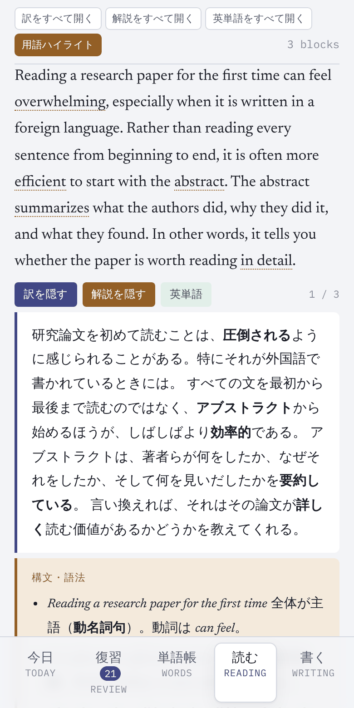
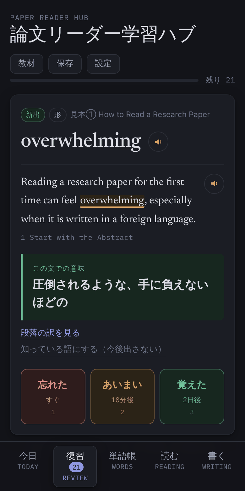
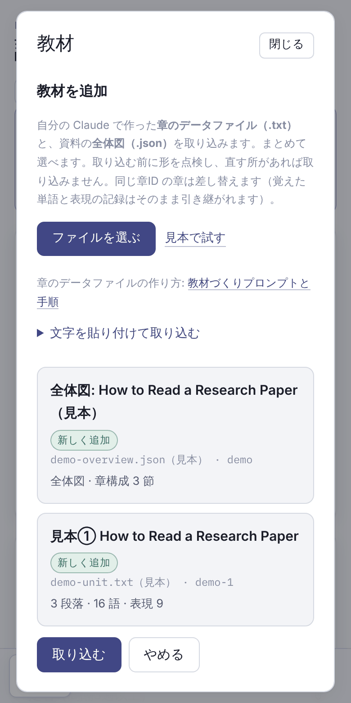
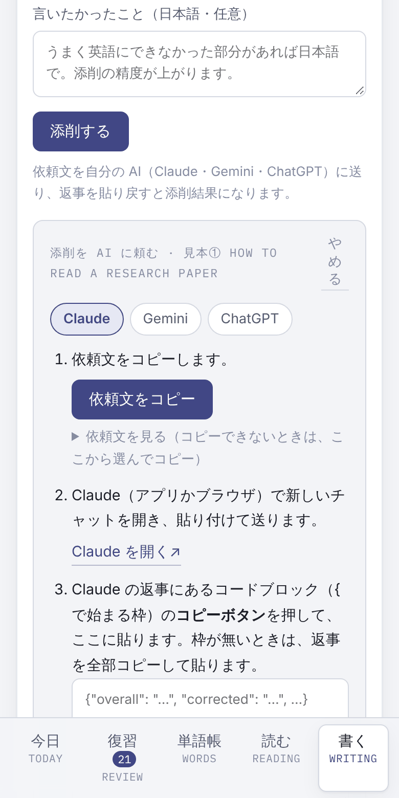
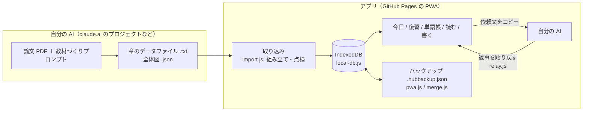

# Paper Reader Hub — 論文リーダー学習ハブ

英語の論文を「英語のまま読む」練習のための、スマホ向け学習アプリ（PWA）です。
自分の AI に作ってもらった章の教材を取り込み、**読む → 単語と表現を復習する → 英語で要約して添削してもらう**を毎日くり返せます。

**アプリ: https://nd33fe66b166265-droid.github.io/paper-reader-hub/** ・ [使い方](docs/usage.md) ・ [教材の作り方](prompts/README.md)

> **In English:** A mobile-first, offline-capable PWA for learning to read English research papers. Users generate chapter
> data (sentences, literal translations, grammar notes, vocabulary, reusable academic phrases) with their own AI, import it,
> and study with spaced repetition. No server, no login: everything lives in the browser's IndexedDB. Vanilla JS, no build step,
> 28 jsdom tests in CI, deployed to GitHub Pages.

<p>
  
  
  
  
</p>

<sub>画面の英文は、このアプリのために書いた見本です（論文からの引用ではありません）。</sub>

## できること

- **読む** — 英文を段落ごとに表示し、「訳（直訳寄り）」「構文解説」「英単語」を必要なときだけ開く。語をタップすると意味が出る。論文の全体図で「今どこを読んでいるか」が分かる。読み上げとシャドーイングも
- **復習** — 読んだ章の単語（英→日）と、論文や発表で使える定型表現（日→英）を間隔反復で覚える。カードには、その語が出てきた元の文が付く
- **書く** — 読んだ章を英語で要約し、自分の AI（Claude・Gemini・ChatGPT）に添削してもらう。間違えた所は復習カードになる
- **記録** — 学習時間の自動計測、週・月のグラフ
- **端末の中だけで動く** — 登録・ログイン・サーバー無し。オフラインでも開ける。バックアップのファイルで、端末の引っ越しや2台（パソコンとスマホ）の記録の合わせができる

## しくみ



このアプリは、もともと claude.ai の Artifact（Claude の中で動く Web ページ）として作り、毎日使っていた学習ハブを、
誰でも使えるスマホのアプリに作り替えたものです。作り替えでは、本体のコードをなるべく変えずに、claude.ai に頼っていた所だけを置き換えました。

| 置き換えた所 | claude.ai 版 | このアプリ |
|---|---|---|
| 保存 | claude.ai のデータベース（`window.claude.use("db")`） | **同じ使い方の部品を IndexedDB で作って差し込んだ**（[`local-db.js`](hub/local-db.js)）。`collection` / `doc` / `where` / `onSnapshot` / `set` など、本体が呼ぶ形はそのまま |
| 教材の登録 | Claude がスクリプトで組み立てて送る | Python の組み立て・点検を **JavaScript に移して**アプリの中で行う（[`import.js`](hub/import.js)。出力が Python 版と同じことをテストで確かめた） |
| 添削 | claude.ai の中の AI を呼ぶ | **API を使わず**、依頼文のコピーと返事の貼り戻しにした（[`relay.js`](hub/relay.js)。前後の文やコードブロックがあっても読み取り、崩れた返事はどこが悪いかを知らせる） |
| 配布 | claude.ai の中だけ | GitHub Pages ＋ Service Worker（[`sw.js`](hub/sw.js)）でホーム画面のアプリに |

### 工夫したところ

- **ネットを先に、だめなら写し**: Service Worker は、通信できるときは毎回最新のファイルを取り（4 秒で返らなければ写しを使う）、公開のたびに古い写しを消す。スマホのアプリが古い版のまま残る問題を避けた
- **記録を壊さない**: 読み込んだ記録は直接書き換えず、写しを作って変える（凍結したオブジェクトを書き換えて失敗した不具合からの決まり）。バックアップを読み込む前の状態は取っておき、ボタン1つで戻せる
- **2台の記録を合わせる**（[`merge.js`](hub/merge.js)）: 同じカードは最後に学習した方、学習時間は端末ごとに足す、復習しなかった日の「ずらし」が二重にかからないように戻す。決まりは [backup-format.md](docs/backup-format.md)
- **外から来たものを信用しない**: 取り込むファイル・AI の返事・バックアップは形と型を確かめてから使う。本文の HTML と図の SVG は、許した要素と属性だけを残して表示する
- **教材を配らない**: 論文の原文と訳は著作物なので、アプリにもリポジトリにも入れない。教材は各自が自分の AI で作る（[教材づくりプロンプト](prompts/paper-reader-prompt.md)を公開）

## 使った技術

- HTML / CSS / JavaScript（フレームワーク・ビルド無し。本体は1つの `index.html` と、役割ごとの小さな部品）
- IndexedDB、Service Worker、Web App Manifest、Web Speech API（読み上げ）、`navigator.storage.persist()`
- テスト: Node.js ＋ [jsdom](https://github.com/jsdom/jsdom) ＋ [fake-indexeddb](https://github.com/dumbmatter/fakeIndexedDB) で、画面を実際に操作する自動テスト 28 本（[`tests/`](tests/)）
- CI / 公開: GitHub Actions（push と PR でテスト、main なら GitHub Pages に公開。公開のたびに版の印を入れる）
- 補助: Python（教材の組み立て・点検の元の版、アイコン作り、claude.ai 版からの移行）、Playwright（画面写真）

## リポジトリの中身

| 場所 | 中身 |
|---|---|
| [`hub/`](hub/) | アプリ本体（このフォルダがそのまま公開される） |
| [`prompts/`](prompts/) | 教材づくりプロンプトと、その使い方 |
| [`docs/`](docs/) | [使い方](docs/usage.md)、[作り替えの計画](docs/PLAN.md)、[バックアップの形](docs/backup-format.md)、[claude.ai 版からの移行](docs/migrate.md)、[claude.ai 版の引き継ぎ資料](docs/hub-README.md) |
| [`tests/`](tests/) | 自動テスト |
| [`tools/`](tools/) | Python の道具と、画面写真を撮るスクリプト |

## 手元で動かす

```sh
cd hub && python3 -m http.server 8000     # http://localhost:8000/ で開く
```

テスト:

```sh
cd tests
npm ci
python3 gen_fixtures.py                    # テスト用の教材（意味の無い語）を作る
HUB=$PWD/../hub/index.html sh run_all.sh   # 28 本
```

## 作った人

電気電子工学を学ぶ学部4年生です。研究室で英語論文を読むために、自分で毎日使う道具として作りました。
コードの多くは AI（Claude）と一緒に書き、仕様と使い心地は自分で決めて確かめています。
